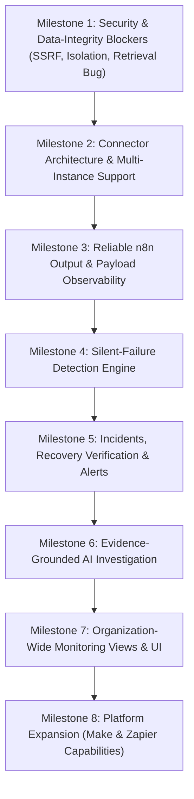

# External Monitoring Implementation Plan

**Goal:** Transform Vantis into the definitive reliability layer for automation platforms (n8n, Make, Zapier), delivering robust SSRF protection, multi-instance scalability, real payload observability, deterministic failure detection, connected incident lifecycles, grounded AI investigation, and cohesive UI views.

---

## Milestone Roadmap & Dependencies

---

## Milestone 1: Security & Data-Integrity Blockers
**Focus:** Outbound HTTP hardening, SSRF prevention, tenant-scoped queries, execution detail retrieval bug fix, and credential protection.

### Work Breakdown
1. **Centralized Hardened HTTP Client (`HardenedHttpClient` / `OutboundHttpService`)**:
   - Custom socket factory / DNS resolver that resolves DNS, checks ALL IPv4 and IPv6 addresses against private (RFC 1918), loopback, link-local (169.254.169.254, metadata), CGNAT, IPv4-mapped IPv6, IDN, decimal/hex IP representations, and connects directly to the pinned IP while retaining the SNI/Host header (preventing DNS rebinding).
   - Configurable private-network allowlist for self-hosted instances (environment/config-level only; never per-tenant user input; default deny).
   - Redirect policy: manual redirection handling with hop limits (<=3), re-running address validation on every hop, stripping sensitive auth headers across host transitions.
   - Enforce connect/read timeouts, max response body size caps (e.g. 5MB), and safe error sanitization.
   - Refactor `N8nClient`, `MakeClient`, `ZapierClient`, and webhook delivery to use this client.
2. **Execution Detail Retrieval Bug Fix**:
   - Add query parameters to `ExecutionEventController.listEvents`: `executionExternalId` and `workflowExternalId`.
   - Update `ExecutionEventService` and repository to filter directly by `(organizationId, executionExternalId)` and `(organizationId, workflowExternalId, executionExternalId)`.
   - Update `api.ts` and the frontend page so execution detail fetches directly by identifier without arbitrary org-wide limits.
3. **Tenant Isolation & Security Hardening**:
   - Verify all repository queries touching integrations, sync state, and events require `organizationId`.
   - Add audit logging for integration connect/disconnect and credential operations.

### Acceptance Criteria & Tests
- Regression tests for loopback (`127.0.0.1`, `[::1]`, `127.0.0.2`), cloud metadata (`169.254.169.254`), RFC 1918, decimal IPs (`http://2130706433`), DNS rebinding simulation (DNS returns public then private IP), redirect chains, and oversized payloads.
- Integration test: tenant B receives 404/403 when requesting tenant A's integration or execution events.
- Test: retrieving external execution by `executionExternalId` succeeds even when >200 newer events exist across the organization.

---

## Milestone 2: Connector Architecture & Multi-Instance Support
**Focus:** Normalized provider adapter registry, multi-instance integration schema, incremental sync cursors, bounded concurrency, and rate-limiting resilience.

### Work Breakdown
1. **Multi-Instance Database Migration (`V26__multi_instance_integrations.sql`)**:
   - Drop `uq_integrations_org_type` constraint.
   - Add unique constraint on `(organization_id, type, name)` or `(organization_id, type, base_url_hash)`.
   - Add instance status / soft-disable support.
   - Ensure backward compatibility: existing integrations and subscriptions remain intact.
2. **Provider Adapter Registry & Capabilities**:
   - Enhance `WorkflowProvider` and `ProviderCapabilities` to declare: `workflowDiscovery`, `executionHistory`, `nodeLevelData`, `outputItemCounts`, `outputStructure`, `errorDetails`, `scheduleDiscovery`, `webhookIngestion`, `rateLimits`.
   - Enforce plan limits on integration count via `BillingService` / `PlanLimits`.
3. **Resilient Incremental Sync Engine**:
   - Bounded concurrency per organization and global worker limits.
   - Circuit breaker and exponential backoff with jitter on 429 (`Retry-After`) and 5xx.
   - Persist sync cursor atomically per instance.
   - Track integration health states: `HEALTHY`, `DEGRADED`, `RATE_LIMITED`, `AUTH_FAILED`, `UNREACHABLE`, `SYNC_STALLED`.

### Acceptance Criteria & Tests
- Migration test verifying existing single-instance rows migrate cleanly without data loss.
- Unit/integration test connecting multiple n8n instances to the same organization.
- Test for 429 rate-limit backoff honoring `Retry-After` header.
- Test enforcing plan integration instance limits.

---

## Milestone 3: Reliable n8n Output & Payload Observability
**Focus:** True n8n payload structure extraction, item counting, structural signatures, redaction, and data-completeness tracking.

### Work Breakdown
1. **n8n Payload Fixture Analysis & Extraction**:
   - Capture sanitized fixtures in `docs/external-monitoring/N8N_PAYLOADS.md` covering: success with items, zero-item success, node execution error, branched execution, multiple runs per node, and pruned data.
   - Parse `runData[nodeName]` correctly: read `data.main` branches, calculate item counts per branch.
   - Extract structural signatures (sorted field paths and primitive/array types; e.g. `{"user.id": "number", "user.email": "string"}`) using `OutputSignatureExtractor`.
   - Never store full customer payloads. Compute salted hashes for values and redact secrets/PII.
2. **Telemetry Ingestion Update**:
   - Update `N8nNodeExecutionMapper` and `IntegrationSyncService` to pass extracted item counts, signatures, and completeness flags (`data_pruned`, `redacted`, `truncated`).
   - Update `TelemetryCollector.captureExternal` to save `outputSignature` and item count to `NodeExecutionMetric`.
3. **Intent-Aware Empty Outputs**:
   - Allow workflows/nodes to define whether empty output is expected or abnormal.
   - Report uncertain low-confidence finding when intent is undetermined.

### Acceptance Criteria & Tests
- Unit tests parsing multiple realistic n8n run payloads.
- Regression test proving that reliance on `run.path("outputSize")` is replaced with true item count and signature calculation.
- Property test for output signature stability under field ordering changes.

---

## Milestone 4: Silent-Failure Detection Engine
**Focus:** Deterministic failure and anomaly detection on external executions using the robust median/MAD baseline engine.

### Work Breakdown
1. **Detectors Configuration & Repair**:
   - Unexpected empty output detector (intent-aware, historical empty-rate baseline).
   - Output volume collapse detector (relative and absolute thresholds against rolling baseline).
   - Output schema and structural drift detector (field additions vs. breaking field removals/type changes).
   - Missing node/path execution detector (conditional branch frequency aware).
   - Latency anomaly detector (workflow- and node-level median/MAD).
   - Volume surge/drop and missed schedule detector (only when schedule is explicitly configured or reliably known).
2. **Cold-Start & Warmup Gating**:
   - Enforce `minSampleCount` before raising actionable alerts.
   - Exclude known anomalous runs from baseline recalculation to prevent baseline corruption.
   - Ensure idempotent reprocessing: re-evaluating the same execution event does not create duplicate anomalies.

### Acceptance Criteria & Tests
- Synthetic scenarios for: true zero-item abnormal success, benign empty output, output volume collapse, schema drift (added field vs deleted field), and latency spike.
- Idempotency test: reprocessing the same execution batch yields 0 duplicate anomalies.

---

## Milestone 5: Incidents, Recovery Verification & Alerts
**Focus:** Connect external anomalies to `IncidentService`, manage lifecycle, verify recovery against baselines, and deliver reliable alerts.

### Work Breakdown
1. **Incident Pipeline Connection**:
   - Wire `AnomalyRecorder` to `IncidentService.create` for anomalies exceeding severity thresholds.
   - Group recurring anomalies into single incident cards using fingerprinting: `(integrationId, workflowId, nodeId, anomalyType, signature)`.
   - Expose acknowledge and resolve flows with audit logging.
2. **Recovery Verification**:
   - Utilize `RecoveryVerificationService` to require subsequent healthy executions against baseline before closing incidents.
   - Reopen or block premature resolution if an anomaly recurs during the cooldown window.
3. **Notification Hardening**:
   - Track notification delivery in `SlackAlertService` and `NotificationService` with retries, exponential backoff, and dead-letter status.
   - Digest/rate-limit alerts to prevent alert floods.
   - Redact all sensitive payload information from notifications.

### Acceptance Criteria & Tests
- Test proving that repeated anomalies for the same failure group update a single incident rather than creating duplicates.
- Test demonstrating that recovery verification prevents premature resolution until clean executions occur.
- Notification tests with mocked Slack webhook including failure and retry handling.

---

## Milestone 6: Evidence-Grounded AI Investigation
**Focus:** Structured incident context contract, strict separation of measured facts from hypotheses, grounding enforcement, and cost/budget controls.

### Work Breakdown
1. **Strict Context & Response Contract**:
   - Formal schema in both Spring Boot and Python FastAPI.
   - Input context: affected workflow, node, measured telemetry vs. baselines, redacted errors, structural diffs, completeness flags.
   - Output schema: `MEASURED_FACTS` (verified subset of input), `HYPOTHESES` (candidate causes with confidence and validation tests), `RECOMMENDED_ACTIONS`.
2. **Grounding & Guardrail Validation**:
   - Post-generation validation in Python service: verify that every metric, node, and error cited in `MEASURED_FACTS` exists in the input context. Drop or flag hallucinated claims.
   - Strict size/token budgets on input evidence packages; truncation of large error snippets.
   - Cache investigations by anomaly fingerprint and baseline version.
   - Graceful fallback: when AI service is unavailable or rate-limited, return deterministic rule-based summary without failing the incident.

### Acceptance Criteria & Tests
- Grounding test: prompt injection or synthetic inputs asserting hallucinated facts are caught and filtered.
- Mocked LLM test suite for timeout, 502, malformed JSON, and rate limit degradation.
- Zero customer content logged in AI service logs.

---

## Milestone 7: Organization-Wide Monitoring Views & UI
**Focus:** Multi-instance management, unified reliability dashboard, capability-aware display, and incident investigation UI in Next.js.

### Work Breakdown
1. **Multi-Instance Connection UI**:
   - Connected integrations list showing instances, health status, last sync timestamp, and backfill progress.
   - Connect/edit dialog supporting custom instance name and base URL.
2. **External Execution & Incident Views**:
   - Update external execution detail page to fetch by ID directly from backend.
   - Connect `/api/incidents` to the frontend: list incidents, filter by status/integration/workflow, and display incident detail page.
   - Evidence timeline: measured metrics vs. baseline, schema diffs, error context.
   - AI Investigation card clearly separating "Measured Facts" from "Hypotheses & Next Steps".
3. **Capability-Aware Degradation**:
   - Display "Unavailable" for unsupported telemetry (e.g. node-level execution data on providers that don't support it); never fabricate zero or fake success scores.

### Acceptance Criteria & Tests
- Frontend vitest tests for multi-instance views, capability badges, and incident cards.
- Lint and typecheck clean (`npm run typecheck`, `npm run lint`).

---

## Milestone 8: Platform Expansion (Make & Zapier)
**Focus:** Capability matrix, honest capabilities, Make execution ingestion repair, and Zapier webhook fallback design.

### Work Breakdown
1. **Capability Matrix Documentation (`CAPABILITY_MATRIX.md`)**:
   - Matrix comparing n8n, Make, and Zapier across all monitoring dimensions.
2. **Make Integration Repair**:
   - Address Make execution ingestion: map scenario runs properly into `ExternalExecution` and create execution events at the scenario level when node-level data is unavailable.
   - Mark node-level metrics as `UNAVAILABLE` rather than failing the sync.
3. **Zapier Instrumentation Fallback**:
   - Documented inbound webhook instrumentation option with HMAC signature verification, timestamp tolerance, and replay prevention.

### Acceptance Criteria & Tests
- Contract tests for Make scenario execution mapping with recorded fixtures.
- Contract test for Zapier webhook ingress with replay attack rejection.

---

## Migration & Rollback Strategy

- **Database Migrations:**
  - Forward-compatible Flyway migrations (`V26__...`).
  - No column drops or destructive modifications on existing `integrations`, `execution_events`, `anomalies`, or `subscriptions`.
  - Provide tested rollback SQL script (`docs/external-monitoring/rollback-V26.sql`).
- **Rollback Procedure:**
  - Backend and frontend deployments can be rolled back to prior revisions without schema conflicts due to additive changes.
